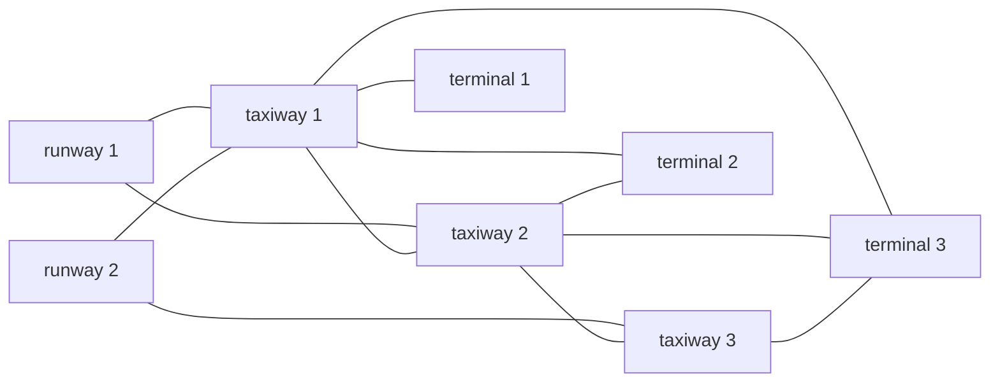

# Airport Ground Operations Planning (PDDL)

A **PDDL 2.1** model (durative actions and numeric fluents) of airport ground operations: aircraft taxiing between runways, electric tractors towing them to the terminals, jet bridges (*fingers*) being deployed and retracted, and chargers where the tractors recharge their batteries.

The problem is solved with the temporal planner **LPG-td**, which searches for a plan that minimizes a combination of total time and number of recharges.

## The domain

**Types:** `aircraft`, `tractor`, `finger`, `pista-aterrizaje` (runway), `pista-rodaje` (taxiway), `terminal`, `cargador` (charger)

| Action | What it does | Duration | Battery |
|---|---|---|---|
| `move-aircraft` | The aircraft taxis on its own between runways and taxiways | distance / aircraft speed | — |
| `move-tractor-empty` | An empty tractor moves between taxiways and terminals | distance / tractor speed | −2 |
| `tow-aircraft` | A tractor tows an aircraft between a taxiway and a terminal | 2 · distance / tractor speed | −4 |
| `deploy-finger` | The aircraft is parked at a free jet bridge of the terminal | `deploy-finger-time` | — |
| `retrieve-finger` | The aircraft leaves the jet bridge and returns to the terminal | `retrieve-finger-time` | — |
| `recharge` | The tractor recharges at a free charger (only if ≤ 6 units left) back to 10 | tractor's `duracion-carga` | → 10 |

Main constraints:
- An aircraft cannot move on its own while it is being towed.
- Tractors only travel on taxiways and terminals. Aircraft only reach a terminal by being towed.
- Each charger and each jet bridge can only be used by one at a time.

**Metric:** `minimize (0.5 · total-time + 10 · numero-recargas)`

## The problem

- 6 aircraft, 2 tractors, 2 runways, 3 taxiways, 3 terminals, 4 jet bridges and 3 chargers.
- **Initial state:** `avion1` and `avion2` have just landed. `avion3`–`avion6` are parked at the jet bridges. The tractors start with low battery (4 and 2 units).
- **Goal:** bring `avion1` and `avion2` to fingers 1 and 3, and move `avion3`–`avion6` out to the runways.



## Running it

### Requirement: LPG-td

To run the problem you need the **LPG-td** planner (`lpg-td.exe`) and the dynamic library **`cygwin1.dll`**. Both can be downloaded (free registration required) from the official website:

👉 **https://lpg.unibs.it/lpg/**

They are not included in this repository because they are third-party software. Once downloaded, place them together in the `ENGINE/` folder:

```
ENGINE/
├── lpg-td.exe
└── cygwin1.dll
```

### Running the planner

From the project root (PowerShell):

```powershell
.\ENGINE\lpg-td.exe -o .\PROBLEM\dominio.pddl -f .\PROBLEM\problema -n 1
```

- `-o`: domain file
- `-f`: problem file
- `-n 1`: number of solutions to search for

The plan found is saved to `plan_problema_1.SOL`.

## Result

LPG-td finds a solution in **0.33 s** with a quality (metric value) of **240.40**. The first actions of the plan look like this (`time: action [duration]`):

```
0.0003:   (MOVE-TRACTOR-EMPTY TRACTOR2 PISTA-RODAJE2 TERMINAL2) [12.0000]
0.0008:   (RETRIEVE-FINGER AVION3 FINGER1 TERMINAL1) [2.0000]
12.0005:  (RECHARGE TRACTOR2 CARGADOR2 TERMINAL2) [14.0000]
26.0045:  (RECHARGE TRACTOR1 CARGADOR2 TERMINAL2) [10.0000]
56.0052:  (TOW-AIRCRAFT TRACTOR1 AVION2 PISTA-RODAJE1 TERMINAL3) [48.0000]
...
```

The full plan is in [`plan_problema_1.SOL`](plan_problema_1.SOL).

## Structure

```
.
├── PROBLEM/
│   ├── dominio.pddl        # Domain definition
│   └── problema            # Problem instance
├── ENGINE/                 # (not included) lpg-td.exe + cygwin1.dll
└── plan_problema_1.SOL     # Plan generated by LPG-td
```

> Identifiers in the PDDL files are in Spanish (*avion* = aircraft, *pista de aterrizaje* = runway, *pista de rodaje* = taxiway, *cargador* = charger, *carga restante* = remaining charge).

## Author

**Brando Fraiz Freire** · [@bran2ff](https://github.com/bran2ff)
